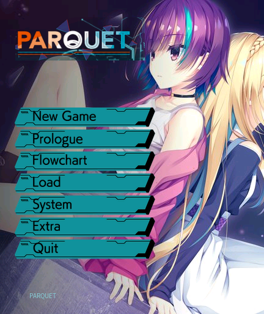
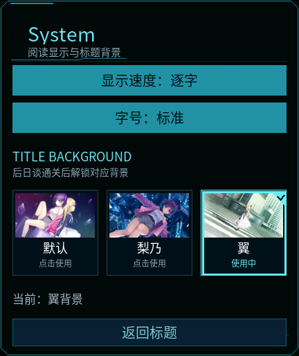

# 《PARQUET》· REDMI Watch 5

由 Codex 完成资源解析、剧情转换、手表运行代码、图像处理与测试，开发者负责需求和实机验收。本项目保留系列手表移植的阅读功能，视觉按《PARQUET》原作重新适配，面向 432 × 514 的 REDMI Watch 5。

[下载最新版本](https://github.com/xuanyide01/parquet-rw5/releases/latest) · [v0.1.5 发布页](https://github.com/xuanyide01/parquet-rw5/releases/tag/v0.1.5)

## 本次输出

版本 **0.1.5**，缩小标题 Logo，完成对应 AFTER STORY 后自动切换标题背景；System 增加即时选框、角标和当前背景提示。安装包 **9,898,785 字节（9.90 MB）**，恢复 10 MB 上限，立绘与表情文件保持 0.1.4 的画质。

[标题背景与包体优化](docs/0.1.5-标题背景与包体优化.md) · [立绘与表情显示修复](docs/0.1.4-立绘与表情显示修复.md) · [章节、圆角与立绘调整](docs/0.1.3-章节与圆角适配.md) · [场景与排版修复](docs/0.1.2-场景与排版修复.md) · [原作 UI 与标题背景](docs/0.1.1-原作UI与标题背景.md)。

## 功能

- 原作简体中文：17 个脚本、107 个场景、11,098 条台词/旁白。
- 按原作顺序阅读 SIDE STORY、正篇和 AFTER STORY；首次 START 进入前传，完成后再次 START 进入正篇。正篇正常流程完成后，AFTER STORY 在标题菜单最上方出现。SIDE STORY 可单独重读。
- 原作后日谈两条结局保留原选项、目标场景和分支标志，不代替玩家作出选择。
- 30 个独立存档栏位，LOAD 自选栏位；覆盖已有存档需确认，可保存待选状态。
- 阅读菜单中的“下一章”按原作章节标签前进；遇到待选项先停下。章节阅读用于回顾，不计入正常通关解锁。
- 自动播放支持慢速/标准/快速；逐字显示约 30 ms/字，显示完成后等待 2.6/1.5/0.8 秒。进入菜单、存读档、触摸正文和后台时暂停，选完选项后继续。重启默认关闭自动播放。
- 上方保留 CG/背景完整画幅，下方为原作风格的黑底青色/紫色消息窗口、白色剧情文字；长文自动换行、可滚动，轻点正文仍可推进。
- 立绘采用上半身裁取、带完整五官的共用身体和完整画布表情层；全部采用相同的原图像素缩放比例，以脸部锚点定位，不因衣服宽度或同屏人数单独缩小，底部贴合文本区；内置中文字体子集，避免依赖系统缺字字库。
- CG 鉴赏含 37 组、367 张图片；同场景差分合并，打开后轻点切换。圆形透明图标、原作英文标题按钮、左侧菜单和标题退出按钮。
- 标题 System 可选择默认、梨乃、翼三张背景；后两张分别在对应后日谈正常通关后解锁并自动切换；也可手动选择，选框、当前背景文字和提示即时反馈，重启保留。正篇完成不会一次解锁全部背景。

## 安装与故障处理

通过[表盘自定义工具](https://www.bandbbs.cn/)向 REDMI Watch 5 安装 `.bin`。手机显示传输完成后，请继续等待手表处理安装，再查看应用列表，避免连续重复传输。

如果安装无图标或无法打开：先等待安装结束，再正常重启手表和手机工具后重试；不要在安装/卸载处理中连续覆盖。仍失败时卸载本应用后重装（本地存档可能丢失），并记录工具版本、手表固件、等待时间和错误提示。应用无响应时先尝试系统返回/电源菜单及正常重启；恢复出厂会清除数据，应作为最后手段而非首选。

此版本不包含音乐、语音、视频与原作动画特效，原作动画使用其配置定义的静态替代图。例如 SD102AB2 按 `envinit.tjs` 的 `altStorage` 使用 SD102AB。剧情、选项与静态画面构成当前阅读范围。

## 验证状态

**v0.1.5 已获用户验收通过（2026-10-30），用户反馈：“测试通过，上传github”。** 用户验收与自动化验证分别记录，见 `reports/user-acceptance-v015.json`。

原作资源逐文件长度与 Adler-32 校验通过；全部中文文本、选项目标和场景边独立比对通过。安装包检查覆盖 ZIP CRC、内外层签名、资源摘要、watch 清单、圆形图标和字体覆盖。31 项软件回归测试通过，包括所有分支、选项前停止跳跃、30 栏位与自动播放。

0.1.2 已验证电话切入和表情、结束后的场景恢复、Another View 的原作背景和 CG。0.1.3 最终包进一步验证原作章节切换、圆角文字边距、Another View 居中、各角色与多人立绘、存读档兼容及正常退出重启；记录见 `reports/native-final-v013/report.json`。0.1.4 已验证旧版存档升级及服务生表情。0.1.5 正式包原生检查与独立 QA 后日谈/选框检查见 `reports/native-v015/report.json`；QA 的终点存档不进入正式包。模拟器为官方通用 Vela Watch 5.0 环境，不等同于 REDMI Watch 5 的具体固件，本版已获用户验收通过；具体自动化测试范围见上述记录。

开发过程中曾在模拟器快速停止、覆盖并立即重启时遇到 SDK inspector `uv_loop_init` 故障，已保留诊断记录并改用独立冷启动复测。此记录不用于宣称实机存在同一故障，也不将其隐藏为“全部测试无异常”。

## 构建与原理

普通构建直接使用 `src` 内已经转换和压缩的资源，不需重新运行 Windows 游戏。

```powershell
npm install --prefix tools/compat-toolkit --ignore-scripts aiot-toolkit@1.1.0
$env:WATCH_COMPAT_TOOLKIT = "$PWD/tools/compat-toolkit/node_modules/aiot-toolkit"
npm test
npm run build
python -X utf8 tools/audit-package.py
```

Node.js 20+，Python 3.11+；审计工具依赖 Pillow、fontTools、cryptography；重新处理立绘另需 NumPy、SciPy。构建沿用已用于前作实机包的 1.1.0 编译器与兼容重封装；在当前构建进程内禁用编译器二次图像压缩，以保留已优化的透明立绘。

转换过程见 `docs/资源提取与转换.md`。Windows 原版 EXE、DLL、XP3、SDK、研究失败的过滤器和私钥均不进入手表包或源码交付包。

## 界面预览






## 原作与致谢

- 《PARQUET》：YUZUSOFTSOUR / JUNOS INC. / NekoNyan / HIKARI FIELD。[原作官网](https://www.yuzusoft-sour.com/products/parquet/index.html) · [Steam 正版页面](https://store.steampowered.com/app/1662840/PARQUET/)。
- @liuyuze61 的《ATRI》移植作品：[作品入口](https://api.bandbbs.cn/wftools/bandbbs.html?code=A&state=1820673)。
- @liuyuze61 的《星空列车与白的旅行》移植作品：[作品入口](https://api.bandbbs.cn/wftools/bandbbs.html?code=A&state=1841662)。
- [表盘自定义工具及 BandBBS 相关团队](https://www.bandbbs.cn/)提供的工具。
- [KiriKiri Z](https://github.com/krkrz/krkrz)、[FreeMote](https://github.com/UlyssesWu/FreeMote)、[GARbro](https://github.com/morkt/GARbro)、[Adobe Source Han Sans](https://github.com/adobe-fonts/source-han-sans)。

自编代码采用 MIT 许可证；原作剧情、图片、字体以及第三方组件不因该许可证变为 MIT。原作素材权利归各自权利人，字体子集采用 SIL OFL 1.1，见 `licenses/SourceHanSans-OFL.txt`。请支持原作。
